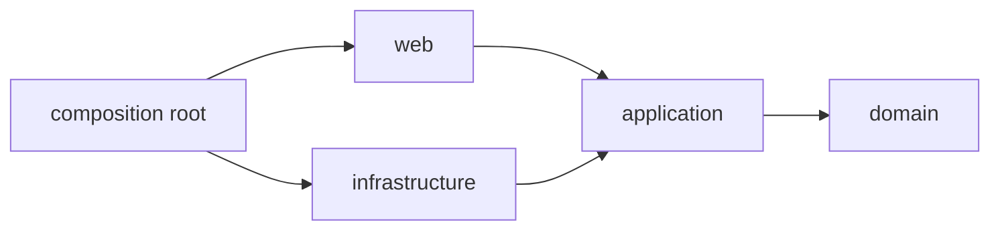
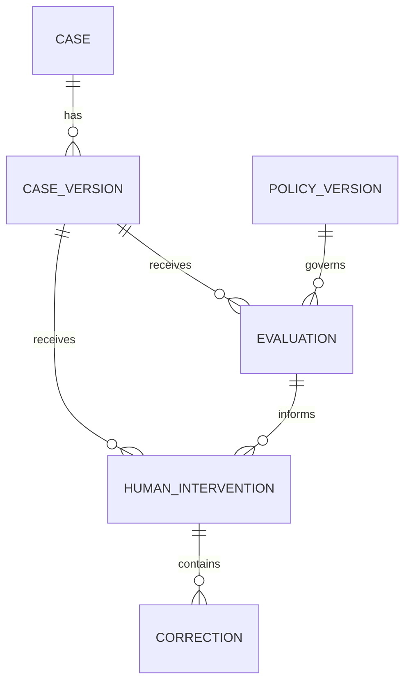

# Architecture Spine — MIRA F4 + F1

## Design Paradigm

Monolito modular con límites hexagonales. `domain` contiene reglas puras; `application` orquesta casos de uso y define puertos; `infrastructure` implementa persistencia, reloj y carga de fixtures; `web` adapta HTTP y templates. Un composition root ensambla adaptadores sin invertir dependencias.



## Invariants & Rules

### AD-1 — Starter local verificable

- **Binds:** base/CAP-1, base/CAP-3, verification/CAP-3
- **Prevents:** que cada historia elija runtime, framework o harness incompatibles.
- **Rule:** usar Python `3.13.16`, Django `5.2.17` LTS y Playwright Python `1.63.0`; dependencias exactas quedan en `uv.lock`. Sustituir este starter requiere una decisión que preserve todos los AD de esta spine.

### AD-2 — Límites de módulos y dirección de dependencias

- **Binds:** all
- **Prevents:** que F4, F1, persistencia y UI dupliquen reglas o creen ciclos.
- **Rule:** dependencias de código siguen `web/infrastructure → application → domain`; solo composition root conoce implementaciones concretas de puertos.

### AD-3 — Política F4 pura y determinista

- **Binds:** f4/CAP-1..CAP-6, verification/CAP-1
- **Prevents:** resultados distintos por interfaz, base de datos, reloj o ejecución de pruebas.
- **Rule:** la evaluación F4 recibe una Versión del caso y una Política completas y devuelve Salida y explicación sin IO, estado global ni lectura del reloj.

### AD-4 — Mutación única y concurrencia optimista

- **Binds:** f1/CAP-4..CAP-6, base/CAP-4
- **Prevents:** que dos rutas sobrescriban una Decisión o acepten una Versión obsoleta.
- **Rule:** toda Decisión o Corrección pasa por un caso de uso de `application` que compara `expected_case_version` con la vigente dentro de una transacción; una diferencia devuelve `stale_version` y no escribe.

### AD-5 — Procedencia append-only

- **Binds:** base/CAP-4, f4/CAP-5..CAP-6, f1/CAP-5..CAP-6, verification/CAP-2
- **Prevents:** pérdida del original, reinterpretación histórica o Discrepancias que muten una Decisión.
- **Rule:** Evaluaciones, Decisiones y Correcciones se agregan; no se actualizan ni eliminan. Una Corrección referencia original y corregido; una Discrepancia referencia Evaluación e Intervención humana sin modificar ambas.

### AD-6 — Política inmutable por versión

- **Binds:** f4/CAP-3..CAP-6
- **Prevents:** que un cambio de umbral altere Evaluaciones previas.
- **Rule:** una Versión de política es inmutable; cada Evaluación persiste su identificador y una copia de parámetros efectivos.

### AD-7 — Tiempo y calendario como puertos

- **Binds:** f1/CAP-7, verification/CAP-1
- **Prevents:** pruebas no reproducibles y cálculos distintos por zona horaria del host.
- **Rule:** plazos consumen `Clock` y `BusinessCalendar`; producción local usa `America/Santiago` y lunes a viernes, mientras pruebas inyectan fecha controlada.

### AD-8 — Fixtures versionados e idempotentes

- **Binds:** base/CAP-5, f4/CAP-7, f1/CAP-8, verification/CAP-1
- **Prevents:** demos divergentes, resultados autorreferentes o datos personales en el repositorio.
- **Rule:** Casos controlados, Evidencia ficticia y resultados esperados son archivos versionados; su loader es idempotente y rechaza IDs duplicados o referencias faltantes.

### AD-9 — Presentación server-rendered y Evidencia primero

- **Binds:** base/CAP-2..CAP-3, f4/CAP-7, f1/CAP-2..CAP-4
- **Prevents:** lógica de decisión duplicada en JavaScript y un orden visual distinto al orden accesible.
- **Rule:** Django renderiza estado y validaciones; JavaScript solo mejora interacción. DOM, templates y respuestas presentan Evidencia, razón y ubicación antes de Puntaje y Señales. `ERROR / DERIVACIÓN` permanece inline en Resultado F4 y no crea proyección de Bandeja.

### AD-10 — Errores y observabilidad seguros

- **Binds:** f4/CAP-1, f1/CAP-6, verification/CAP-2
- **Prevents:** manejo divergente de fallos y filtración de Evidencia o secretos.
- **Rule:** errores cruzan límites como `code`, `message` y contexto seguro; logs contienen IDs de Caso, Versión, Política y request, nunca contenido de Evidencia, comentarios libres ni secretos.

### AD-11 — Persistencia local transaccional

- **Binds:** base/CAP-4, f1/CAP-4..CAP-7
- **Prevents:** dos fuentes de verdad o escrituras parciales en el incremento.
- **Rule:** SQLite es el único store local; repositorios de `infrastructure` ejecutan transacciones cortas y exponen a `application` entidades de dominio, no modelos ORM.

### AD-12 — Sobre operativo acotado

- **Binds:** base/CAP-3, verification/CAP-3..CAP-7
- **Prevents:** que historias introduzcan infraestructura productiva o servicios externos fuera de alcance.
- **Rule:** la versión candidata corre como un proceso web local y una base local; instalación, fixtures y pruebas parten de un clon limpio. No hay auth, colas, almacenamiento cloud ni integraciones externas.

### AD-13 — Vocabulario compartido con dueño único

- **Binds:** base/CAP-4, f4/CAP-1..CAP-7, f1/CAP-1..CAP-8
- **Prevents:** enums, estados, prioridades, razones o formatos de explicación incompatibles entre F4, F1 y UI.
- **Rule:** `domain` es el único dueño de `F4Outcome`, `CaseStatus`, `Priority`, contratos de explicación y esquema de `ReasonCategory`; este último valida código, acción compatible y comentario obligatorio para `other`. Web e infrastructure importan esos tipos y no declaran equivalentes locales.

### AD-14 — Bandeja como proyección, no fuente de verdad

- **Binds:** f1/CAP-1..CAP-2, f1/CAP-7..CAP-8
- **Prevents:** estado de Bandeja que diverja de Evaluaciones, Intervenciones o plazos.
- **Rule:** la Bandeja es una query projection derivada de la Evaluación vigente, Intervenciones append-only y calendario; solo `REVISIÓN` y `ESCALADO` ingresan, y ninguna ruta escribe estado directamente en una fila de Bandeja.

### AD-15 — Escenario reproducible de rendimiento

- **Binds:** base/CAP-1, f1/CAP-2, verification/CAP-5
- **Prevents:** aceptar `p95 ≤ 2 s` con una interacción, carga o entorno ambiguos.
- **Rule:** NFR-3 mide desde la acción de abrir un Caso en la Bandeja hasta que su detalle queda visible, con 100 Casos y 3 Evidencias por Caso, Django + SQLite local limitado a 2 vCPU y 4 GiB, 5 ejecuciones de calentamiento y 30 muestras medidas; el p95 debe ser `≤ 2 s`.

### AD-16 — Presupuesto reproducible de recursos

- **Binds:** base/CAP-1, f1/CAP-2, verification/CAP-5
- **Prevents:** afirmar eficiencia sin incluir el navegador ni fijar métrica, sesión y umbral.
- **Rule:** PX-08 ejecuta 30 revisiones consecutivas con Playwright y `psutil`, mide los árboles de procesos de Django y Chromium durante toda la sesión y exige RSS máximo agregado `≤ 1 GiB` y CPU promedio agregado `≤ 1 núcleo lógico`.

## Consistency Conventions

| Concern | Convention |
|---|---|
| Naming | Entidades y clases en `PascalCase`; módulos, funciones y campos en `snake_case`; vocabulario del PRD en nombres de dominio. |
| IDs | Identificadores UUID serializados como strings; IDs de fixtures conservan `CC-F4-NN` y `CC-F1-NN`. |
| Numbers | Puntaje, Señales y umbrales usan `Decimal`; nunca `float`. |
| Serialization | Valores decimales cruzan límites como strings con punto; la UI puede mostrarlos con coma sin cambiar el valor canónico. |
| Dates | Instantes ISO 8601 con zona; fechas hábiles como `date`; zona de negocio `America/Santiago`. |
| Errors | Códigos estables `invalid_input`, `stale_version`, `reason_required`, `not_found`; mensaje en español en web. |
| State mutation | Comando de `application` + transacción + evento append-only; templates y vistas no escriben directamente al ORM. |
| Configuration | Política y fixtures son datos versionados; secretos, si aparecen en el futuro, solo por entorno y nunca en fixtures. |
| Tests | Nombres citan CAP y Caso controlado; unitarias prueban dominio, integración prueba repositorios y E2E usa Playwright. |

## Stack

Verificado contra documentación oficial el 2026-10-03.

| Name | Version |
|---|---|
| Python | 3.13.16 |
| Django | 5.2.17 LTS |
| SQLite | Bundled with Python 3.13.16 |
| Playwright for Python | 1.63.0 |

## CAP-1 Decision Register

| Question | Decision | Responsible | Date |
|---|---|---|---|
| OQ-2 — Rendimiento | Aplicar AD-15: apertura Bandeja → detalle, 100 Casos, 3 Evidencias por Caso, 2 vCPU/4 GiB, 5 calentamientos, 30 muestras y `p95 ≤ 2 s`. | Arquitectura + Sebastián | 2026-10-03 |
| OQ-3 — Recursos | Aplicar AD-16: 30 revisiones Playwright, medición de los árboles de procesos de Django y Chromium con `psutil`, RSS máximo `≤ 1 GiB` y CPU promedio `≤ 1 núcleo lógico`. | QA + Arquitectura | 2026-10-03 |
| OQ-4 — Tecnología | Aceptar AD-1, AD-4 y AD-11: Python 3.13.16, Django 5.2.17 LTS, Playwright Python 1.63.0, SQLite local y concurrencia optimista por `expected_case_version`. | Arquitectura | 2026-10-03 |

## Structural Seed

```text
src/mira/
  domain/          # entidades, valores, Política F4 y reglas puras
  application/     # casos de uso, comandos, queries y puertos
  infrastructure/  # ORM, repositorios, Clock, calendario y fixture loader
  web/             # rutas, formularios, templates y mejora progresiva
  composition.py   # ensamblaje único de adaptadores
fixtures/          # Casos controlados y Evidencia ficticia
tests/
  unit/            # dominio determinista
  integration/     # persistencia, concurrencia, fixtures y calendario
  e2e/             # recorridos F4 → F1 con Playwright
manage.py
pyproject.toml
uv.lock
```



## Capability → Architecture Map

| Capability / Area | Lives in | Governed by |
|---|---|---|
| base/CAP-1 | `composition.py`, settings, test configuration | AD-1, AD-2, AD-12, AD-15, AD-16 |
| base/CAP-2 | `web` and domain-owned `ReasonCategory` catalog | AD-9, AD-13 |
| base/CAP-3 | composition, `web`, test harness | AD-1, AD-2, AD-12 |
| base/CAP-4 | `domain`, application ports, repositories | AD-2, AD-4, AD-5, AD-11 |
| base/CAP-5 | `fixtures`, loader, test factories | AD-8 |
| f4/CAP-1..CAP-6 | `domain/policy`, Evaluation repository | AD-3, AD-5, AD-6, AD-10, AD-13 |
| f4/CAP-7 | `web`, fixtures, E2E | AD-8, AD-9 |
| f1/CAP-1..CAP-3 | application queries, `web` | AD-7, AD-9, AD-13, AD-14 |
| f1/CAP-4..CAP-6 | application commands, repositories | AD-4, AD-5, AD-10, AD-11 |
| f1/CAP-7 | Clock, BusinessCalendar, queue query | AD-7, AD-11 |
| f1/CAP-8 | `web`, fixtures, E2E | AD-8, AD-9 |
| verification/CAP-1..CAP-7 | tests, traceability artifacts, README | AD-1, AD-8, AD-10, AD-12, AD-15, AD-16 |

## Deferred

- **Producción:** hosting, PostgreSQL, autenticación, secretos, observabilidad externa, backups y migración operacional quedan fuera hasta que el alcance incluya despliegue productivo.


> Reconciliación 2026-10-04: runtime efectivo Django 5.2.17 aprobado por usuario en story 1.3 y plan de cierre; el historial original permanece en Git.
