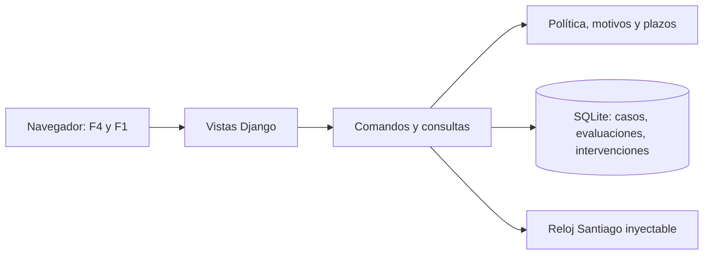

# MIRA · Entrega 2 · candidato local

Grupo: 

Lukas Scheel · Francisca Meyer · Sebastián Rodríguez. Representante del cliente E2: Sebastián Rodríguez (en E1: Lukas Scheel). Fecha: 2026-10-04. Commit técnico `622f1c89a62469fbfb53fcfcf2774980a1cad2b3`. Estado: candidato local; v2.0 final reservada para cierre validado.

## 6.1 Resumen ejecutivo

Se construyeron una política de decisión conservadora y una bandeja para revisar casos con evidencia ficticia, mediante BMAD. Respecto de E1, los tres cambios principales son: concretar las barreras de aprobación y sus fronteras; transformar la revisión humana en acciones con motivos, correcciones y protección frente a dos operadores; y convertir plazos y conservación del historial en comportamientos verificables. La aplicación permite recorrer ambas funciones y conserva las intervenciones al reiniciar. Recomendamos realizar la prueba externa de usabilidad y la aceptación de Sebastián, y repetir las mediciones en el equipo limitado acordado antes de declarar la versión final. La medición local de CPU excede el umbral y requiere validación; no se presenta como cumplimiento.

## 6.2 Introducción y selección de funcionalidades

MIRA apoya decisiones empresariales sobre evidencia multimodal. E2 transforma parte del análisis E1 en un incremento web: F4 consume puntajes/señales del motor simulado; F1 recibe sus casos derivados y permite decidir con evidencia. Ambas funciones están conectadas por el mismo caso y evaluación. La selección cruza H-15 (mínimos por señal sin precisar), riesgo de aprobación sin sustento y HU-03/04; cumple la conexión exigida por el enunciado (§4.2). La [baseline](../LLM%20-%20MIRA_E2_Baseline_F4_F1.md) conserva RQF-004/005/014 y requisitos de apoyo.

El equipo consta de Lukas Scheel, Francisca Meyer y Sebastián Rodríguez; Sebastián rota como representante del cliente E2 según bitácora §6. BMAD está materializado en `_bmad/`, `_bmad/config.toml` y `_bmad-output/`; no se encontró una versión semántica verificable. Se identifica el snapshot técnico por commit `622f1c89a62469fbfb53fcfcf2774980a1cad2b3` y el antecedente aprobado `e429d4d5f10b4cc4d897f820add33e74981ee4f2`, sin inventar versión del framework o del modelo generador. Stack reproducible: Python 3.13.16, Django 5.2.17 aprobado, SQLite, Playwright 1.63.0, pytest y psutil fijados en `uv.lock`.

## 6.3 Aplicación del método

| Fase | Entrada → salida efectivas | Ajuste documentado |
|---|---|---|
| Análisis | E1 + baseline → brief V2 en `_bmad-output/planning-artifacts/briefs/brief-Software-asistido-por-LLMs-2026-09-27-v2/brief.md` | Bitácora §13 valida alcance F4/F1 y mínimo 70; no se crea fórmula de scoring. |
| PRD y aclaraciones | Brief + DEC-E2-01…07 → `initiative-mira-e2-f4-f1/prd-mira-f4-f1/prd-mira-f4-f1.md` | Catálogo por acción, Otro con comentario y calendario/alertas precisos. |
| UX y arquitectura | PRD → `ux-mira-f4-f1/DESIGN.md`, `EXPERIENCE.md`, `architecture-mira-f4-f1/ARCHITECTURE-SPINE.md` | Evidencia primero, SQLite/CAS y AD-15/16; runtime efectivo 5.2.17 reconciliado. |
| Contratos y planificación | PRD/arquitectura → SPEC + companions y tickets épicas 2/3/4; plan de cierre | Aprobación A y trabajo en main registrados en e429d4d; prioridades sin ampliar funciones. |
| Implementación | Plan aprobado → src, fixtures y migración (622f1c8) | Diccionario sustituido por persistencia; decisiones versionadas y correcciones. |
| Verificación/revisión | SPEC, PF/PX y corpus → suites, JSON QA y matriz | Prueba de carrera detectó bloqueo del SQLite en memoria; se verifica con base SQLite de archivo. Sesiones humanas pendientes. |

Dos traducciones concretas: DEC-01 de E1 (nunca rechazo automático y T candidato) llega a barreras versionadas y pruebas PF-04; DEC-10/11 (3/5 días, evidencia antes del puntaje, motivo y original) llega al brief validado, PRD FR-9/11/12/15/16 y pruebas PF-05/14. Preguntas Q-01/02 sobre mínimos y umbral se resuelven con DEC-E2-01/02 (70 y 90 para piloto); Q-03 rechaza que F4 calcule score; Q-05 concreta categorías; Q-07 fija Santiago L-V. La baseline §13 y bitácora §9 contienen esas respuestas, sin atribuir intervenciones nuevas a Sebastián.

Corrección explícita antes/después: el starter (`356b4d5`, `domain/review.py`) marcaba discrepancia al aprobar/rechazar. El plan registra la regla aprobada por el usuario DEC-E2-08: el operador declara desacuerdo con motivo; una corrección marca discrepancia; decidir por sí solo no. `58b5a59` explicita esa semántica, `e429d4d` registra aprobación A y `622f1c8` implementa checkbox, comentario y pruebas. Es una corrección impulsada/aprobada por el usuario de esta sesión, no un acta de Sebastián.

Valor/costo: contratos y corpus aportan el mayor valor técnico observable porque permitieron detectar persistencia y concurrencia faltantes y comprobar fronteras independientemente. La duplicación de SPEC en dos ubicaciones y la reconciliación del runtime exigen mantenimiento sin comportamiento adicional: costo documental visible, no costo monetario medido. La verificación exige además instalación de Chromium y medición real; no hay registro fiable de horas del equipo, tokens o precio para compararlos. Esta evaluación es técnica, no una reflexión humana inventada.

## 6.4 Implementación

Arquitectura: navegador → vistas Django → comandos/consultas de composición y aplicación → reglas de dominio; adaptador SQLite guarda snapshots y eventos. El reloj Santiago se comparte y puede inyectarse. No hay llamadas a motor real ni servicios productivos.

Datos efectivos: `CaseRecord(case_id, version, payload, current_values)`; `EvaluationRecord(case, case_version, inputs, policy, result)` conserva evaluación original; `InterventionRecord(case, version, kind, payload)` conserva decisiones/correcciones, autor declarado, fecha, motivo y discrepancia. La restricción caso/versión es única. CAS incrementa la versión y agrega evento en una sola transacción. La API/modelos de historial impiden modificar/eliminar registros existentes; administración SQL directa queda fuera de esta demo local.

Funcionan F4 completo del corpus, borrador corregible de error, enrutamiento, PDF/PNG reales ficticios, decisiones con categorías, correcciones, conflicto, historial y ambos plazos. Parcial: acreditación extra-funcional en AD-15; identidad es declarada, sin autenticación productiva. Fuera: nuevas evidencias, reapertura completa, panel agregado supervisor, motor, F2/F3/F5…F9 y publicación remota. Una corrección del importe no recalcula la evaluación ni invalida decisión.

Capturas verificables del candidato: [F4](qa/f4.png), [F1 con evidencia primero](qa/f1.png). No son capturas de aceptación humana.

Autoría aproximada con evidencia: `622f1c8` registra 38 archivos cambiados, 1442 inserciones y 129 eliminaciones por autor técnico Codex; ese delta fue generado por el agente. No existe en este incremento un commit de código escrito directamente por el equipo que permita asignarle porcentaje. El usuario revisó y corrigió intención (DEC-E2-08/runtime/plan), no se convierte esa aprobación en autoría de líneas. La procedencia humana del código histórico no se infiere; se conserva su historial.

## 6.5 Pruebas y verificación

25 pruebas Django y 4 pytest pasan. PF-04 se concreta en CC-F4-01…09 y pruebas con salidas esperadas de `policy-cases.md`: fronteras 59,99/60/90/90,01, fraude, señal69,99/ausente, OFF y error. Se agregan NaN/Infinity y precedencia de error para evitar una aprobación accidental. PF-05 se concreta en CC-F1-01…04: motivo/categoría incompatible/Otro vacío, 120000→100000, antecedentes, versión obsoleta; PF-14 conserva calendario y alertas CC-F1-05/06. Estas son reformulaciones ejecutables del contrato, sin sustituir los criterios E1.

`tests/test_e2e.py` recorre por Chromium las nueve salidas F4 y la recuperación de error; F1 inspecciona PDF/PNG, verifica evidencia antes del score, corrige, solicita antecedentes, mantiene decisión en conflicto entre pestañas y muestra vencido abierto. `ConcurrentReviewTests` usa dos conexiones SQLite reales; `test_restart.py` escribe y lee desde procesos nuevos. PX-09 del corpus ficticio pasa; no implica validez del motor real ni habilita ampliación del piloto.

Extra-funcional: 100 casos/3 evidencias, 5 calentamientos/30 muestras; p95 0.4871s (umbral≤2s). Treinta revisiones: RSS máximo 803.9MiB (≤1GiB), CPU promedio 1.2759 núcleos (≤1, excedido). Equipo detectado:12lógicos/34224758784bytes RAM; no acredita 2vCPU/4GiB. Veredicto diagnóstico, NFR-3 no certificado y PX-08 observado falla CPU; [configuración y muestras](qa/measurements.json). No se inventan límites de hardware.

Reproducción técnica de git archive limpio:8,65s con caché local, [pasos](qa/reproducibility.json). No acredita instalación sin caché ni sesión externa<15min. PX-05 con integrante externo y aceptación de Sebastián no realizados: [registro pendiente](qa/actas-pendientes.md), con campos para tareas/tiempo/dificultades y criterios aceptados/rechazados. No se sustituye a personas por pruebas automatizadas.

## 6.6 Comparativa con la Entrega 1

El enunciado exige dos tablas y tres indicadores pero no publica su formato/fórmulas. La clasificación y métricas siguientes son propuestas explícitas para este informe, no una escala oficial. Se evalúa únicamente la baseline F4/F1, sin afirmar cobertura de todo MIRA.

| Requisito E1 | Clasificación propuesta | Cambio/resultado y evidencia |
|---|---|---|
| RQF-004 Must | Precisado, conservado | T90, mínimos70 y precedencia; FR1…6, SPEC-F4, PF04. |
| RQF-005 Must | Precisado, conservado | Motivos por acción, CAS, importe original/corregido; FR7…14, SPEC-F1, PF05. |
| RQF-014 Must | Precisado, conservado | 3/5 días Santiago L-V; FR15/16, PF14; vencido abierto. |
| RQF-003 Must apoyo | Adaptado al motor simulado | Señales/hallazgos ficticios visibles; FR6/9, PDFs/PNG; no se implementa inferencia. |
| RQF-008 Must apoyo | Recortado a F4/F1 | Procedencia/evaluación/intervención durable; FR5/17, reinicio; F6 completo fuera. |
| RQNF-009 Must | Precisado para corpus | PX09 nueve salidas; piloto sin ampliación ni tasa objetivo. |
| RQNF-001 Must | Precisado, validación parcial | AD15 y script p95; hardware acordado no acreditado. |
| RQNF-005 Should | Conservado, pendiente | Orden visual verificado; PX05 con externo pendiente. |
| RQNF-008 Should | Precisado, validación parcial | PX08 instrumentado; CPU observado excede umbral. |

| Supuesto/decisión | Origen verificable | Evolución y quién consta |
|---|---|---|
| T candidato, nunca rechazo automático | DEC01; baseline§4 | DEC-E2-02 limita90 al piloto; bitácora§9; pruebas respetan. |
| Mínimos sin fijar (H15) | baseline§5 y PF04 m70 | DEC-E2-01/04 precisa70 y dos señales; aclaración documentada, no inferencia nueva. |
| F4 calcula score | descripción/enunciado frente a E2 motor simulado | DEC-E2-03 aclara consumo; baseline§11; no inventa fórmula. |
| 3 versus5 días | DEC10/H16 | DEC-E2-07 separa meta y compromiso; reloj controlado. |
| Evidencia primero y original íntegro | DEC11/H18 | FR9/12 y pruebas; usabilidad externa aún pendiente. |
| Discrepancia automática al decidir | starter356b4d5 frente a plan | Usuario aprueba DEC-E2-08, 58b5a59/e429d4d; agente implementa declaración/corrección. |
| Django5.2.18 declarado | arquitectura/SPEC inicial | Usuario aprobó5.2.17 en story1.3; reconciliación efectiva, historial conservado. |

Indicadores: (1) **Cobertura contractual de Must seleccionados** = Must de baseline con SPEC+historia+código+prueba / Must seleccionados =7/7×100=100%; [matriz](trazabilidad-must.md). Cuenta existencia de cadena, no aprobación de NFR3. (2) **Exactitud del corpus F4** = salidas esperadas correctas / CC-F4 ejecutados =9/9×100=100%; PF04/pytestE2E. Limitación: corpus ficticio pequeño, no generaliza a fraude real. (3) **Cumplimiento extra-funcional observado** = umbrales satisfechos / umbrales medidos =2/3×100=66,7% (p95 y RSS sí; CPU no); JSON QA. Limitación: entorno no acreditado; certificación AD15=0 sesiones acreditadas/1requerida, no se mezcla con cumplimiento observado.

**A1—Cambios:** la tabla clasifica los nueve requisitos de la baseline; los cambios relevantes precisan barreras, motivos, concurrencia y plazos. No se reescriben retroactivamente IDs E1. **A2—Must sin cadena:** ninguno de los siete seleccionados carece de cadena contractual/técnica; NFR3 tiene prueba y evidencia, pero no aceptación en hardware. Must de F2/F3/F5…F9 están fuera por selección explícita F4/F1, no por olvido; no se afirma inventario total E1. **A3—Agregado sin fuente:** marcar discrepancia por toda aprobación/rechazo fue una interpretación del agente del starter, corregida por DEC-E2-08 con criterio de desacuerdo explícito. No se aceptó como nueva regla de negocio. **A4—RNF no automatizable:** PX05 y aceptación humana no pueden certificarse por navegador; necesitan personas, no es un defecto que pueda resolverse cambiando código. AD15 sí es automatizable, pero aquí limita el entorno, y PX08 falla el umbral observado.

**B1—Supuestos invalidados:** la persistencia en memoria del starter no cumplía reconstrucción/reinicio y la discrepancia automática no correspondía al desacuerdo declarado; auditoría/plan registran esos problemas, el usuario aprueba cierre y el agente cambia implementación. No se atribuye su detección a Sebastián. **B2—Decisiones respetadas/contradichas:** se respetan DEC01/10/11 (política/plazos/evidencia); starter contradijo conservación y semántica de desacuerdo, y contratos divergían del runtime autorizado. La comparación de 356b4d5/4337a3a con622f1c8 y bitácora§14 documenta corrección. DEC08 sobre nueva evidencia se mantiene fuera según SPEC-F1, sin simular reapertura. **B3—Ambigüedad resuelta por agente:** prioridad y permanencia operativa de antecedentes abiertos se proyectan desde estados/contratos; creación de borrador corregido usa nuevo identificador para preservar fixture. Son opciones técnicas del agente; no hay evidencia de coincidencia personal con Sebastián, que deberá evaluar en aceptación.

**C1—Hallazgos:** H15 se precisa con70 para piloto, no calibración productiva; H18 tiene tarea definida, pero validación externa pendiente. Nuevas brechas de implementación: memoria pierde historial, carrera y discrepancia implícita; quedan corregidas. Queda abierta acreditación AD15 y CPU. **C2—Contradicciones de arquitectura:**5.2.18 versus5.2.17 se reconcilia; no se construye motor real aunque la tabla mínima del enunciado menciona cálculo, pues §4.3 y DEC-E2-03 explican motor simulado. No se incorpora F6 completo. **D1—Modelo:** casos incorporan versión/valores actuales; evaluación conserva inputs/política/result; intervención agrega versión, kind y payload. Son necesarios para reconstrucción y CAS, sin expediente F6. **D2—Precisión de aceptación:** PF04 tiene fronteras útiles; mínimos, catálogo y calendario requieren DEC-E2-01/05/07. PF05 necesita convertir “motivo” a códigos de categoría y versión esperada; PX08/AD15 necesitan volumen/herramienta/umbrales concretos. SPEC companions son la reformulación ejecutable, sin elegir expectativas desde resultados del código.

## 6.7 Discusión

La evidencia técnica muestra una diferencia entre disponer de artefactos y cumplirlos. El starter ya mostraba decisiones, pero memoria y ausencia de CAS impedían la conservación y protección exigidas. Los SPEC y companions permiten detectar esa pérdida sin que una demo visual la oculte. Al mismo tiempo, repetir contratos en dos árboles dejó versiones del runtime divergentes: documentar más no aseguró coherencia. La revisión del usuario fijó una semántica de desacuerdo que el código no debía inferir.

La prueba de carrera real aporta más control que probar dos decisiones secuencialmente; la lectura desde un proceso nuevo distingue persistencia de una variable compartida. La medición de CPU que excede el umbral también contradice una declaración simple de “todas las pruebas pasan”. BMAD aporta estructura y trazabilidad, pero exige verificación independiente de expectativas y límites claros de aceptación. Frente al prompting de E1, se gana evidencia ejecutable; no hay métricas comparables de esfuerzo/tokens para afirmar menor costo. Estas observaciones no sustituyen una reflexión personal del equipo: esa participación humana queda pendiente de revisión del informe.

## 6.8 Conclusiones

El candidato demuestra cómo convertir requisitos conservadores y de revisión humana en contratos, código y pruebas auditables: barreras F4, evidencia F1, originales preservados y un ganador ante concurrencia. El aprendizaje verificable está en esa cadena de artefactos y comprobaciones, no en una afirmación sobre capacidades personales no evaluadas. Para el cierre final quedan PX05 externo, reproducción externa, entorno AD15, validación/resolución de CPU y aceptación de Sebastián. La siguiente entrega debe ampliar evidencia de validación antes de ampliar automatización.

Anexos: [matriz completa](trazabilidad-must.md), [hashes](qa/hashes.json), [bitácora](../LLM%20-%20MIRA_Entrega2_bitacora_decisiones.md), [prompts históricos](../prompts_completos.md), [guion](guion-presentacion.md), [actas pendientes](qa/actas-pendientes.md). Fuente de estructura: `Contexto-fase1-bmad/LLM - Entrega_2_MIRA_SDD_BMAD.pdf`, págs7–10; se conserva la propuesta de indicadores como tal.
