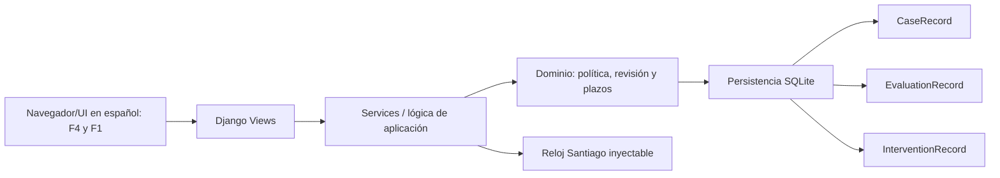

# MIRA Entrega 2

Informe de desarrollo y evaluación del incremento F4 y F1

Universidad de Valparaíso. Escuela de Ingeniería Informática. Taller de Desarrollo de Software Conducido por Agentes de IA.

Integrantes: Francisca Meyer, Lukas Scheel y Sebastián Rodríguez. Representante del cliente E2: Sebastián Rodríguez. Método: BMAD. Herramienta de asistencia: Codex. Configuración del método: `_bmad/config.toml`, snapshot `a59ab9c`; versión semántica no registrada.

Fecha: 4 de octubre de 2026. Versión de entrega: `v2.0`. Las evidencias históricas de pruebas, sesiones y mediciones se conservan con la versión técnica verificada `v2.0-rc1`, commit `0ccb92f0ffae7ca6b1ad4af4f1d19263a0437327`.

## 6.1 Resumen ejecutivo

Se construyó una aplicación web de MIRA que conecta F4, decisión por umbrales, con F1, bandeja de revisión asistida. Con datos ficticios, la aplicación permite evaluar un caso, explicar por qué se deriva a revisión, consultar evidencia y registrar una decisión, corrección o solicitud de antecedentes con motivo e historial.

El trabajo se desarrolló con BMAD a partir de la Entrega 1. Los tres cambios más relevantes fueron: fijar reglas verificables para aprobar o derivar casos, transformar la revisión humana en acciones justificadas que conservan el dato original y agregar persistencia con control de versiones para evitar pérdida de historial o dobles decisiones sobre el mismo caso.

Sebastián aceptó F4 y F1 en una sesión global sin observaciones. La prueba con dos personas externas mostró que el flujo se puede completar, pero también que la orientación visual requiere mejora y que PX-05 no queda formalmente acreditada. La latencia y memoria cumplen en el entorno medido; la CPU supera el umbral y fue aceptada por el cliente como excepción, no como cumplimiento técnico. Antes de ampliar el alcance se recomienda mejorar la orientación visual, repetir la instalación sin caché externa, acreditar usabilidad bajo las condiciones de la pauta y validar rendimiento en 2 vCPU/4 GiB.

## 6.2 Introducción y selección de funcionalidades

MIRA es una plataforma de apoyo a decisiones empresariales a partir de evidencia multimodal. La Entrega 1 organizó requisitos, decisiones, hallazgos y backlog; la Entrega 2 convierte una selección de ese análisis en software ejecutable y trazable.

Elegimos **F4, puntaje y decisión por umbrales**, y **F1, bandeja de revisión asistida**. F4 consume puntajes y señales del motor simulado y aplica la política de decisión; los casos derivados se revisan en F1 sobre la misma evaluación. Esta conexión cumple la regla de selección del enunciado. El riesgo principal es aprobar sin sustento o perder el fundamento de una intervención. La selección aborda H-15, mínimos individuales sin precisar, y H-18, presentación de evidencia para revisión humana, y conserva HU-03/04 y RQF-004/005/014 como origen.

El equipo está integrado por Francisca Meyer, Lukas Scheel y Sebastián Rodríguez. El representante del cliente rota de Lukas en E1 a Sebastián en E2. La baseline F4/F1 y las secciones 1 a 13 de la bitácora registran selección, aclaraciones y validación del brief, sin modificar retroactivamente los artefactos de E1.

El método es **BMAD**, con los roles Analyst, PM, UX, Architect, PO, SM, Dev y QA, y con configuración y artefactos conservados en `_bmad/` y `_bmad-output/`. Los contratos SPEC complementan el trabajo de los roles con expectativas ejecutables. La configuración `_bmad/config.toml` y el snapshot `a59ab9c` identifican la implementación utilizada; no consta una versión semántica verificable del framework. La herramienta de asistencia fue Codex, sin atribuirle un modelo no documentado.

El stack efectivo es Python 3.13.16, Django 5.2.17, SQLite, Playwright 1.63.0, pytest y psutil, fijados en `uv.lock`. Django ofrece formularios, plantillas y pruebas integradas; SQLite facilita ejecución local sin servicios adicionales. El dominio mantiene sus reglas separadas de interfaz y persistencia. El motor multimodal real queda fuera, conforme al alcance de E2.

## 6.3 Aplicación del método

### Recorrido desde E1 hasta la implementación

La entrada del método fue la baseline específica F4/F1, extraída del análisis E1. El brief V2 fue validado antes del PRD; luego se generaron UX, arquitectura, validaciones, cuatro SPEC y 33 historias. El plan de cierre documentó las correcciones al starter y la revisión posterior comprobó contratos y comportamiento.

| Fase | Entrada y artefacto producido | Ajuste documentado |
|---|---|---|
| Analyst | Análisis E1 y baseline hacia Product Brief V2. | Brief validado: F4/F1, parámetros del piloto y ausencia de rechazo automático. |
| PM | Brief y DEC-E2-01 a 07 hacia PRD y addendum. | Motivos por acción, Otro con comentario y calendario precisados. |
| UX Expert | PRD hacia DESIGN y EXPERIENCE. | Evidencia primero y flujos de error, decisión, corrección y conflicto. |
| Architect | PRD y UX hacia ARCHITECTURE SPINE. | SQLite, versiones, transacciones y mediciones; runtime efectivo 5.2.17. |
| PO | PRD y arquitectura hacia validaciones de consistencia. | Se comprobaron referencias y contratos; la divergencia tecnológica quedó registrada. |
| SM | Cuatro SPEC y épicas hacia 33 historias. | Capacidades vinculadas a FR/NFR y HU-03/04; dependencias verificadas. |
| Dev | Plan aprobado hacia código, fixtures y migraciones. | Persistencia sustituye memoria; decisiones y correcciones versionadas. |
| QA | Contratos, PF/PX y corpus hacia suites, mediciones y revisión. | Carrera con SQLite de archivo, regresiones de errores y sesiones humanas de cierre. |

### Traducción de decisiones y aclaraciones

**Primer ejemplo.** DEC-01 de E1 mantiene el umbral como candidato y prohíbe el rechazo automático. El brief conserva esa restricción; DEC-E2-01/02/04 concretan T=90 y mínimos de 70 para autenticidad y coherencia. SPEC-F4 y PF-04 verifican fronteras, señales ausentes y fraude con precedencia. Una entrada incompleta nunca se transforma en aprobación.

**Segundo ejemplo.** DEC-10/11 fijan plazos, evidencia antes del puntaje, motivo y conservación del original. El PRD los traduce a FR-9/11/12/15/16. F1 preserva el importe original y muestra la meta interna de tres días hábiles y el compromiso contractual de cinco, en America/Santiago y de lunes a viernes.

Q-01/02 resolvieron mínimos y umbral mediante decisiones del piloto. Q-03 aclaró que F4 consume el puntaje y no inventa scoring. Q-05 fijó categorías por acción y comentario obligatorio para Otro; Q-07 concretó calendario y alertas. La baseline y la bitácora 9 registran las respuestas, sin atribuir al cliente intervenciones individuales no documentadas.

### Corrección humana con antes y después

El starter `356b4d5` marcaba discrepancia al aprobar o rechazar. El usuario corrigió esa interpretación y aprobó DEC-E2-08: decidir no implica desacuerdo, el operador lo declara con comentario y una corrección registra discrepancia. `74b8149` y `1cd0378` documentan intención y aprobación; `a59ab9c` incorpora el comportamiento y las pruebas. La decisión funcional correspondió al usuario y la generación del parche al agente.

La arquitectura y UX se revisaron mediante validaciones de consistencia y referencias; la fragmentación comprobó capacidades, historias y dependencias. El runtime inicialmente declarado como Django 5.2.18 se reconcilió con 5.2.17, autorizado en story 1.3 y efectivo en el entorno. Las secciones 14 a 20 de la bitácora y los registros QA preservan esos cambios.

### Valor y costo del método

Los contratos y QA aportaron el mayor valor técnico observable: las fronteras, los reinicios y la carrera detectaron propiedades que una demo visual no demostraba. El costo menos productivo fue mantener SPEC duplicados y reconciliar referencias tecnológicas. Esa evaluación se apoya en los artefactos corregidos; no hay horas, tokens o costos fiables para cuantificar ahorro frente a E1.

## 6.4 Implementación

La aplicación sigue un monolito modular. Las vistas reciben la interacción del navegador; los servicios coordinan reglas de dominio y persistencia. SQLite guarda evaluaciones e intervenciones y el reloj controlado de Santiago hace reproducibles los plazos. No hay llamadas al motor real ni servicios productivos.

**Modelo efectivo.** `CaseRecord(case_id, version, payload, current_values)`; `EvaluationRecord(case, case_version, inputs, policy, result)` conserva evaluación original; `InterventionRecord(case, version, kind, payload)` conserva decisiones/correcciones, autor declarado, fecha, motivo y discrepancia. La restricción caso/versión es única. CAS incrementa la versión y agrega evento en una sola transacción. La API/modelos de historial impiden modificar/eliminar registros existentes; administración SQL directa queda fuera de esta demo local.

**Estado funcional.** Funcionan F4 sobre el corpus, borrador corregible de error, enrutamiento, PDF/PNG reales ficticios, decisiones con categorías, correcciones, conflicto, historial y ambos plazos. Parcial: acreditación extra-funcional en AD-15; identidad es declarada, sin autenticación productiva. Fuera: nuevas evidencias, reapertura completa, panel agregado supervisor, motor y F2/F3/F5…F9. Una corrección del importe no recalcula la evaluación ni invalida decisión.

**Interfaz.** Capturas del candidato: [F4](qa/f4.png), [F1 con evidencia primero](qa/f1.png). No son capturas de aceptación humana.

**Procedencia del código.** En el delta auditado del candidato, `a59ab9c` registra 38 archivos cambiados, 1442 inserciones y 129 eliminaciones con identidad Git de Lukas Scheel Belmar, tras la reescritura autorizada; ese delta fue generado por el agente. No se implementaron líneas de código directamente por el equipo; en cambio, el equipo realizó correcciones sobre la implementación mediante revisiones e instrucciones canalizadas a través del agente LLM. Por eso no se presenta un porcentaje ficticio de autoría histórica si no existe evidencia fiable para hacerlo. Los parches de revisión están en `0166caa` y el grafo actualizado en `ab745af`, también generados por el agente.

## 6.5 Pruebas y verificación

### Pruebas funcionales y extremo a extremo

El cierre técnico publicado registra **33 pruebas Django y 8 pytest aprobadas**. Las pruebas funcionales derivadas de PF-04 cubren CC-F4-01 a 09: fronteras 59,99/60/90/90,01, fraude, señal menor de 70 o ausente, OFF y error. NaN e Infinity se agregan como excepciones para evitar aprobación accidental. PF-05 prueba motivo obligatorio, categorías compatibles, Otro con comentario, corrección 120000 a 100000 y conflicto de versión. PF-14 conserva plazos y vencidos abiertos. Son precisiones ejecutables de los criterios E1.

Chromium recorre F4 con recuperación de error y F1 con evidencia, corrección, solicitud y conflicto, por lo que existe un recorrido E2E de ambas funcionalidades en la interfaz. Dos conexiones SQLite verifican carrera y procesos nuevos comprueban persistencia. PX-09 alcanza las nueve salidas del corpus. Las ediciones documentales requieren renovar FR-20 al versionarse; los resultados históricos corresponden a `v2.0-rc1`.

### Rendimiento y aceptación de la desviación

Se midieron 100 casos con tres evidencias, cinco calentamientos y 30 muestras. Los recursos se observaron durante 30 revisiones, con 84 muestras y sin brechas de contadores [R3].

| Indicador | Observado | Umbral | Resultado |
|---|---|---|---|
| Latencia p95 | 0,5228 s | ≤ 2 s | Cumple en el entorno medido. |
| Memoria máxima | 798,2 MiB | ≤ 1 GiB | Cumple en el entorno medido. |
| CPU promedio | 1,3237 núcleos | ≤ 1 núcleo | Exceso de 32,4 %, aceptado por el cliente. |

El cliente acepta el rendimiento actual sin observaciones, incluida la desviación de CPU [R6]. Se conserva el umbral original; no se atribuye el exceso a error de medición. El anfitrión tenía 12 procesadores lógicos y 34.224.758.784 bytes de RAM. `hardware_ad15_accredited=false` mantiene pendiente la acreditación en 2 vCPU/4 GiB. La aceptación de una excepción no acredita AD-15/PX-08.

### Usabilidad y aceptación funcional

Dos participantes externas al proyecto completaron una tarea F4 de evaluación y explicación y una tarea F1 de revisión de evidencia y solicitud de antecedentes. El equipo confirmó que los datos del acta corresponden a sesiones realizadas [R4]. Esta evidencia se informa como validación parcial de usabilidad, no como acreditación completa de PX-05.

| Participante | Tiempo F4 | Tiempo F1 | Ayudas | Resultado |
|---|---|---|---|---|
| Fernanda Meyer, 21 años | 1 min 13 s | 2 min 2 s | Una por tarea | Ambas completadas con asistencia. |
| Ximena Belmar, 53 años | 57 s | 1 min 21 s | Ninguna | Ambas completadas de forma autónoma. |

Fernanda fue observada por Francisca el 04/10 a las 11:05; necesitó identificar botones y comprender secciones. Ximena fue observada por Lukas el 03/10 a las 21:09, sin dificultades. Las actas declaran v2.0-rc1 sin commit individual de sesión. Estos datos justifican mejorar orientación; dos personas no permiten generalizar por edad. No consta pertenencia a otro equipo universitario ni confirmación explícita de ausencia de instrucciones previas, condiciones formales de PX-05.

Sebastián probó F4/F1 el **04/10/2026 a las 13:00** y aceptó ambas por responder a lo solicitado, sin observaciones ni rechazos [R5]. El acta registra aceptación global por funcionalidad, no validación criterio por criterio.

| Funcionalidad | Criterio aceptado con evidencia | Resultado | Limitación |
|---|---|---|---|
| F4 | Responde a la evaluación por política del piloto y muestra resultado y explicación. | Aceptada globalmente. | No desglosa umbral, mínimos, fraude ni errores como criterios individuales. |
| F1 | Responde a revisión humana y registro de intervención. | Aceptada globalmente. | No desglosa evidencia, motivo, corrección, conflicto ni plazos como criterios individuales. |

No se registraron rechazos en la sesión de aceptación. No se presenta una matriz de aceptación punto por punto debido a que el cliente aceptó globalmente ambas funcionalidades sin observaciones ni rechazos, por lo que no fue necesario registrar una justificación individual para cada criterio. La reproducción técnica local pasó dependencias, migraciones, demo, 33 pruebas y acceso a ambas funciones. El README explica el proceso completo; la comprobación usó caché local, sin acreditar descarga externa desde GitHub/uv ni sesión de una persona externa en menos de 15 minutos [R7].

## 6.6 Comparativa con la Entrega 1

El enunciado exige dos tablas y tres indicadores, pero no publica un formato completo ni sus fórmulas. La clasificación y métricas siguientes son propuestas explícitas para este informe, no una escala oficial. Se evalúa únicamente la baseline F4 y F1, sin afirmar cobertura de todo MIRA.

### Evolución de requisitos

| Requisito E1 | Clasificación propuesta | Cambio/resultado y evidencia |
|---|---|---|
| RQF-004 Must | Precisado, conservado | T90, mínimos 70 y precedencia; FR1…6, SPEC-F4, PF04. |
| RQF-005 Must | Precisado, conservado | Motivos por acción, CAS, importe original/corregido; FR7…14, SPEC-F1, PF05. |
| RQF-014 Must | Precisado, conservado | 3/5 días Santiago L-V; FR15/16, PF14; vencido abierto. |
| RQF-003 Must apoyo | Adaptado al motor simulado | Señales/hallazgos ficticios visibles; FR6/9, PDFs/PNG; no se implementa inferencia. |
| RQF-008 Must apoyo | Recortado a F4/F1 | Procedencia/evaluación/intervención durable; FR5/17, reinicio; F6 completo fuera. |
| RQNF-009 Must | Precisado para corpus | PX09 nueve salidas; piloto sin ampliación ni tasa objetivo. |
| RQNF-001 Must | Precisado, validación parcial | AD15 y script p95; hardware acordado no acreditado. |
| RQNF-005 Should | Validado parcialmente con personas | Orden visual y dos sesiones externas; orientación mejorable y condiciones formales PX-05 sin acreditar íntegramente. |
| RQNF-008 Should | Medido y aceptado con excepción | RSS cumple; CPU excede umbral. Cliente acepta resultado [R6]; hardware requerido sin acreditar. |

### Supuestos y decisiones

| Supuesto/decisión | Origen verificable | Evolución y quién consta |
|---|---|---|
| T candidato, nunca rechazo automático | DEC01; baseline §4 | DEC-E2-02 limita 90 al piloto; bitácora§9; pruebas respetan. |
| Mínimos sin fijar (H15) | baseline §5 y PF04 m 70 | DEC-E2-01/04 precisa 70 y dos señales; aclaración documentada, no inferencia nueva. |
| F4 calcula score | descripción/enunciado frente a E2 motor simulado | DEC-E2-03 aclara consumo; baseline §11; no inventa fórmula. |
| Tres frente a cinco días | DEC10/H16 | DEC-E2-07 separa meta y compromiso; reloj controlado. |
| Evidencia primero y original íntegro | DEC11/H18 | FR9/12 y pruebas; sesiones externas identifican dificultad de orientación [R4]. |
| Discrepancia automática al decidir | starter 356b4d5 frente a plan | Usuario aprueba DEC-E2-08, 74b8149/1cd0378; agente implementa declaración/corrección. |
| Django 5.2.18 declarado | arquitectura/SPEC inicial | Usuario aprobó 5.2.17 en story1.3; reconciliación efectiva, historial conservado. |
| Aceptación funcional y rendimiento | Cierre técnico anterior con sesiones pendientes | Sebastián acepta F4/F1 [R5]; cliente acepta rendimiento con desviación CPU [R6]. Equipo registra; agente instrumenta medición. |

### Indicadores calculados

**I1 Cobertura de trazabilidad de Must seleccionados.** Must de la baseline con SPEC, historia, código y prueba divididos por Must seleccionados: **7/7 × 100 = 100 %** [R2]. Mide existencia de cadena, no cumplimiento certificado de NFR-3. La matriz desarrolla 22 FR/NFR derivados.

**I2 Exactitud de la política en el corpus F4.** Salidas esperadas correctas divididas por casos F4 ejecutados: **9/9 × 100 = 100 %**. Las expectativas provienen de `policy-cases.md`, verificadas por PF-04 y E2E. El corpus ficticio pequeño no demuestra exactitud del motor ni fraude real.

**I3 Cumplimiento extra-funcional observado.** Umbrales satisfechos divididos por umbrales medidos: **2/3 × 100 = 66,7 %** [R3]. p95 y RSS cumplen, CPU no. La aceptación del cliente conserva ese numerador. La acreditación AD-15 se informa aparte y sigue pendiente.

### Respuestas sobre requisitos y decisiones

**A1 Cambios.** la tabla clasifica los nueve requisitos de la baseline; los cambios relevantes precisan barreras, motivos, concurrencia y plazos. No se reescriben retroactivamente IDs E1.

**A2 Must sin cadena.** ninguno de los siete seleccionados carece de cadena contractual/técnica; NFR3 tiene prueba y evidencia, pero no aceptación en hardware. Must de F2/F3/F5…F9 están fuera por selección explícita F4/F1, no por olvido; no se afirma inventario total E1.

**A3 Agregado sin fuente.** marcar discrepancia por toda aprobación/rechazo era una regla del starter, de origen no acreditado, corregida por DEC-E2-08 con criterio de desacuerdo explícito. No se aceptó como nueva regla de negocio; no se atribuye su autoría histórica al agente.

**A4 RNF no automatizable.** La comprensión en PX-05 no puede certificarse por navegador: las dos sesiones registradas aportan tiempos y dificultades, pero no acreditan todas las condiciones formales del participante. Es una limitación de evidencia automática, no del requisito. AD-15 sí es medible; aquí limita el entorno y PX-08 falla CPU, aunque el cliente acepta la desviación.

**B1 Supuestos invalidados.** la persistencia en memoria del starter no cumplía reconstrucción/reinicio y la discrepancia automática no correspondía al desacuerdo declarado; auditoría/plan registran esos problemas, el usuario aprueba cierre y el agente cambia implementación. No se atribuye su detección a Sebastián.

**B2 Decisiones respetadas y contradichas.** se respetan DEC01/10/11 (política/plazos/evidencia); starter contradijo conservación y semántica de desacuerdo, y contratos divergían del runtime autorizado. La comparación de 356b4d5/4337a3a con a59ab9c y bitácora§14 documenta corrección. DEC08 sobre nueva evidencia se mantiene fuera según SPEC-F1, sin simular reapertura.

**B3 Ambigüedad resuelta por el agente.** prioridad y permanencia operativa de antecedentes abiertos se proyectan desde estados/contratos; creación de borrador corregido usa nuevo identificador para preservar fixture. Son opciones técnicas del agente; Sebastián aceptó el resultado global sin observaciones [R5]. Esa aceptación respalda el comportamiento presentado, pero no prueba una aprobación individual retrospectiva de cada opción técnica.

### Respuestas sobre consistencia y calidad

**C1 Hallazgos.** H15 se precisa con 70 para piloto, no calibración productiva; H18 dispone de sesiones externas y dificultad de orientación identificada; faltan condiciones formales de PX-05. Nuevas brechas de implementación: memoria pierde historial, carrera y discrepancia implícita; quedan corregidas. Queda abierta acreditación AD15; CPU permanece como excepción aceptada por el cliente, sin cambiar el umbral.

**C2 Contradicciones de arquitectura.** La divergencia entre Django 5.2.18 y 5.2.17 se reconcilia. No se construye el motor real aunque el menú del enunciado menciona cálculo, pues su sección 4.3 y DEC-E2-03 establecen puntajes y señales simulados. F6 completo queda fuera del alcance.

**D1 Modelo.** casos incorporan versión/valores actuales; evaluación conserva inputs/política/result; intervención agrega versión, kind y payload. Son necesarios para reconstrucción y CAS, sin expediente F6.

**D2 Precisión de aceptación.** PF04 tiene fronteras útiles; mínimos, catálogo y calendario requieren DEC-E2-01/05/07. PF05 necesita convertir “motivo” a códigos de categoría y versión esperada; PX08/AD15 necesitan volumen/herramienta/umbrales concretos. SPEC companions son la reformulación ejecutable, sin elegir expectativas desde resultados del código.

El cierre técnico fue revisado con cuatro lentes BMAD; los hallazgos, refutaciones y parches están en [registro de revisión](qa/review-bmad.md). No hubo hallazgos diferidos; las sesiones humanas se incorporan en los registros [R4/R5], mientras el entorno acordado sigue sin acreditar.

## 6.7 Discusión

BMAD aportó una estructura útil para conservar la relación entre necesidades y comportamiento. La baseline evitó reiniciar el análisis desde la descripción general y los contratos convirtieron decisiones en comprobaciones. Persistencia y carrera muestran su mayor beneficio: un formulario podía parecer terminado y aun así perder historial o aceptar dos cambios sobre el mismo estado. Esas propiedades necesitaron pruebas independientes del recorrido visual.

El método también generó mantenimiento sin comportamiento adicional. Las copias de SPEC y las referencias tecnológicas divergentes exigieron reconciliación. La existencia de documentos no demuestra coherencia: deben compararse con runtime, datos y pruebas. La revisión del usuario fue necesaria para impedir que el agente tratara una decisión humana como desacuerdo implícito.

La validación con personas aporta otra clase de evidencia. Fernanda completó el recorrido con ayuda para localizar botones y entender secciones; Ximena lo resolvió sin asistencia. La diferencia señala una oportunidad de orientación, pero la muestra no permite afirmar que la interfaz es universalmente intuitiva ni establecer diferencias por edad. La aceptación global de Sebastián respalda la adecuación general a lo solicitado en la sesión registrada y conserva las dificultades de uso como oportunidades de mejora.

El rendimiento exige separar satisfacción del cliente y acreditación técnica. El cliente acepta la desviación de CPU porque considera aceptable el resultado actual, mientras el requisito mantiene su umbral. Esta decisión no transforma el entorno medido en 2 vCPU y 4 GiB. Conservar ambos resultados permite justificar aceptación sin ocultar límites.

Frente al prompting directo de E1, E2 añade código ejecutable, pruebas y control del historial; mejora la posibilidad de verificar decisiones y detectar pérdida entre especificación e implementación. No contamos con métricas comparables de horas o tokens para afirmar menor esfuerzo. SDD podría haber centrado el proceso en la especificación; en este proyecto, el control observable provino de revisar contratos y someterlos a pruebas además de organizar el trabajo por roles.

## 6.8 Conclusiones

El incremento demuestra que el equipo ahora puede llevar una baseline de requisitos a una aplicación con dos funcionalidades conectadas, preservar decisiones de origen y localizar su evidencia en contratos, historias, código y pruebas. El aprendizaje principal fue que una especificación asistida por agentes solo es confiable cuando se contrasta con decisiones, runtime, datos y pruebas ejecutables; en este caso, esa revisión permitió descubrir problemas de persistencia, concurrencia y semántica de discrepancia que una demo visual no habría mostrado.

F4 y F1 están disponibles y fueron aceptadas por Sebastián sin observaciones. Las sesiones externas aportaron tiempos y dificultades, y el cliente aceptó el rendimiento con una excepción de CPU. El README ofrece una secuencia completa de instalación y ejecución comprobada con caché local.

Como cierre formal de la entrega quedan pendientes verificables: exportar y revisar el PDF final, repetir instalación sin depender de caché local, acreditar PX-05 con un integrante de otro equipo y sin instrucciones previas y medir AD-15 en 2 vCPU/4 GiB. El siguiente incremento debe mejorar la orientación de interfaz y ampliar evidencia de validación antes de extender automatización.

## Anexos y referencias

### Referencias del repositorio

- **R1** `LLM - MIRA_E2_Baseline_F4_F1.md`: decisiones E1 y DEC-E2, requisitos, hallazgos y preguntas.
- **R2** `docs/trazabilidad-must.md` y `docs/qa/traceability.json`: siete Must y 22 FR/NFR derivados.
- **R3** `docs/qa/measurements.json`: revisión medida ab745af, configuración y muestras. La medición anterior se conserva en `measurements-historical-a59ab9c.json`.
- **R4** `docs/qa/usabilidad-px05.md`: sesiones y datos confirmados por el equipo.
- **R5** `docs/qa/aceptacion-sebastian.md`: aceptación de F4/F1 el 04/10/2026 a las 13:00.
- **R6** `docs/qa/aceptacion-rendimiento.md`: aceptación con desviación de CPU.
- **R7** `README.md`, `docs/qa/instalacion-readme.md` y `docs/qa/reproducibility.json`: instrucciones y comprobaciones de instalación.
- **R8** `LLM - MIRA_Entrega2_bitacora_decisiones.md`: secuencia del trabajo y revisión documental.
- **R9** `_bmad/config.toml`, `_bmad-output/planning-artifacts/` e iniciativa F4/F1: brief, PRD, UX, arquitectura, validaciones, SPEC, historias y plan.
- **R10** `docs/qa/review-bmad.md`, `review-fixes.md`, `tests/README.md` y `src/mira/web/tests.py`: revisión y pruebas.
- **R11** Descripción MIRA, informe E1 y `Contexto-fase1-bmad/LLM - Entrega_2_MIRA_SDD_BMAD.pdf`: fuentes y estructura académica, secciones 4 a 6.
- **R12** `prompts_completos.md`, artefactos del método, historial Git y `docs/qa/commit-author-map.json`: evidencia de asistencia y procedencia.

### Capturas de las funcionalidades

Las capturas corresponden al candidato técnico y muestran la política F4 y la evidencia e intervención F1. Las actas se conservan por separado; las imágenes no sustituyen las sesiones humanas.
